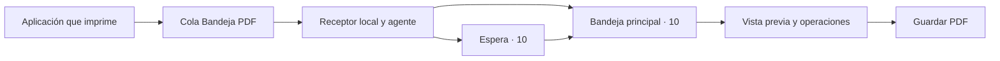

# Bandeja PDF

Impresora virtual y bandeja de documentos para macOS. Recibe impresiones, permite previsualizar y organizar páginas, y guarda el resultado como PDF.

**Estado: 0.1.0, prototipo funcional de desarrollo para Apple Silicon.** Hay una instalación local probada; todavía no hay un instalador público firmado y notarizado. El código declara macOS 15 como mínimo, pero la compatibilidad en todas las versiones admitidas aún debe verificarse.

## Qué hace

- Recibe PDF y PostScript mediante una cola de impresión propia.
- Mantiene una bandeja principal de 10 documentos y otra de espera de 10.
- Permite importar PDF, buscar texto existente, unir documentos, girar, ordenar, extraer, mover, copiar y quitar páginas.
- Conserva los originales para trabajar mediante referencias a sus páginas.
- Exporta sin reescribir el PDF cuando no se ha modificado su composición.
- Muestra una ventana propia cuando ambas bandejas están llenas. Los trabajos adicionales pueden descartarse; no depende del Centro de notificaciones de macOS.

La impresión desde aplicaciones antiguas es parte del proyecto. En los reportes de SIDUNEA examinados, las letras ya llegan como contornos: se conserva su apariencia, pero no se recupera texto seleccionable. **Esta versión no incluye OCR ni recompone tablas.**

## Recorrido



La interfaz y el agente son procesos separados. Cerrar la ventana no detiene al agente registrado en la sesión gráfica. La disponibilidad tras reiniciar, suspender o bloquear el Mac todavía requiere pruebas específicas.

## Empezar a desarrollar

Se necesita un Mac con Apple Silicon y herramientas de desarrollo de Apple con un SDK compatible. El paquete Swift no depende de paquetes externos:

```sh
git clone https://github.com/cesarpaz-dev/bandeja-pdf.git
cd bandeja-pdf/native
swift build --configuration release --arch arm64
```

Esto compila el código; no instala una impresora. Para crear el paquete `.app` hace falta aportar un runtime Ghostscript preparado por separado. Los requisitos, las pruebas y los pasos que sí modifican la instalación están en la [guía de desarrollo](docs/DEVELOPMENT.md).

## Documentación

| Documento | Contenido |
| --- | --- |
| [Uso](docs/USAGE.md) | Bandejas, edición, exportación y avisos. |
| [Arquitectura](docs/ARCHITECTURE.md) | Componentes, almacenamiento, recepción y límites. |
| [Desarrollo](docs/DEVELOPMENT.md) | Compilación, dependencias, instalación local y pruebas. |
| [Validación](docs/TESTING.md) | Qué se ha comprobado y qué falta. |
| [Próximos pasos](docs/ROADMAP.md) | Trabajo pendiente, separado de las funciones actuales. |
| [Preparación de GitHub](docs/PUBLISHING.md) | Revisión del árbol público y primera publicación. |
| [Contribuir](CONTRIBUTING.md) | Cambios, incidencias y datos de prueba. |
| [Cambios](CHANGELOG.md) | Historial de versiones. |

## Estructura del repositorio

```text
docs/               Guías y estado del proyecto
native/
  Sources/          Interfaz, agente, almacenamiento, protocolo y CLI
  Resources/        Metadatos de la app y PPD propio
  Tests/            Pruebas con documentos sintéticos
  scripts/          Construcción, instalación y diagnóstico
scripts/            Revisión del contenido publicable
.github/            Validación automática y plantillas
```

Los reportes reales, datos de la aplicación, capturas, historial de diagnóstico y binarios no forman parte del repositorio público.

## Límites actuales

Los PDF cifrados se rechazan. Los documentos con formularios o marcadores se pueden exportar sin cambios, pero su composición está bloqueada. Las pruebas no garantizan fidelidad de todos los tipos de PDF.

El receptor escucha en loopback. Eso limita su exposición a la red, pero **no autentica a otras cuentas locales**. El producto aún necesita resolver ese aislamiento, la recuperación ante fallos y reintentos, y la distribución a otros equipos. No se promete entrega sin pérdidas ni exactamente una vez.

## Licencia

El código propio y la documentación se distribuyen bajo **GNU AGPL versión 3 solamente**, identificador `AGPL-3.0-only`. Consulta [LICENSE](LICENSE).

Ghostscript y las demás dependencias conservan sus propias licencias. El repositorio no incluye sus binarios; crear una distribución requiere cumplir las condiciones de todos los componentes que incorpore. Consulta [THIRD_PARTY_NOTICES.md](THIRD_PARTY_NOTICES.md).
